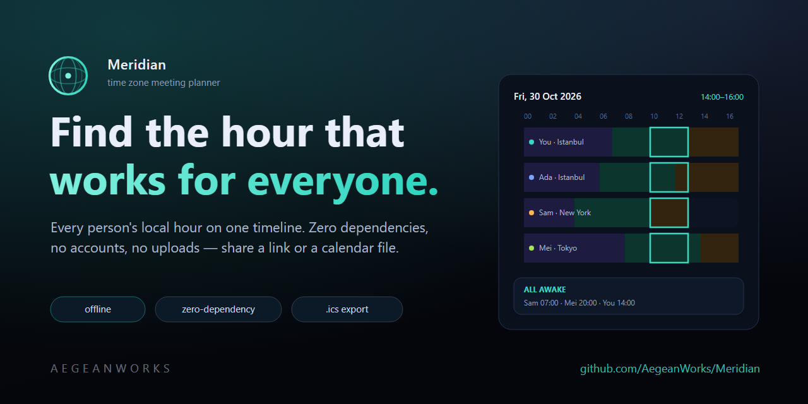
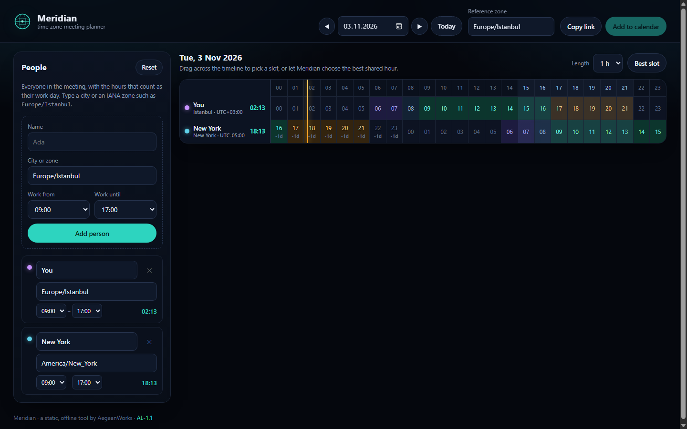
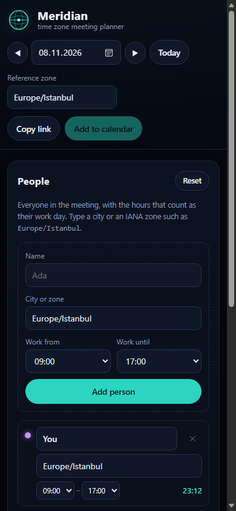

# Meridian

<!-- aegean:media:start -->
<p align="center"></p>
<p align="center"><a href="LICENSE"></a> <a href="https://github.com/AegeanWorks/AIKit"></a></p>
<!-- aegean:media:end -->


A zero-dependency time zone meeting planner that runs entirely in the browser: add people and cities, compare every local hour side by side, find the overlap that works for everyone, then share it as a link or a calendar file.

**Live:** <https://aegeanworks.github.io/Meridian/>

Meridian is a static site. There is no build step, no server, no account and no upload: the page reads the browser's own IANA time zone database through `Intl`, keeps the whole plan in the URL hash, and works offline once loaded.

## ⚡ 30-Second Cold-Start Quick Reference

- **Runtime Prerequisites**: Node.js 20+ for the local static server and the test suite; Node.js 22+ for the headless WebSocket dogfood (it skips cleanly on older Node). Any modern browser (Chromium, Firefox or Safari). No `npm install`, no third-party packages, no network access.
- **Run it locally**:
  ```bash
  npm start          # serves http://127.0.0.1:4179/ and opens it
  ```
  Double-click **`play.cmd`** on Windows or run **`./play.sh`** elsewhere for the same thing.
- **Canonical Regression Shield Gate**:
  ```bash
  npm test           # node --test tests
  npm run dogfood    # headless Edge/Chrome pass over the real UI
  ```
- **Deploy it**: the repository root is the site, already served at <https://aegeanworks.github.io/Meridian/> through GitHub Pages (`master`, `/`). A fork only needs Pages pointed at its root; there is nothing to build.

### 🛠️ AIKit Commands (run from the AIKit folder)
| Role | Command |
|---|---|
| Status, task and gates | `python aikit.py status meridian` |
| Phase 4: every gate | `python aikit.py check meridian` |
| Repair memory and map, then check | `python aikit.py fix meridian` |
| Resume an interrupted task | `python aikit.py resume meridian` |

## ✨ What It Does

- **Everyone on one grid.** Each participant gets a row; the 24 columns are the hours of the chosen day in a reference zone, and every cell shows that person's own local hour (with a `+1d` / `-1d` marker when their date differs).
- **Work hours decide quality.** Each person has a work-day start and end; cells inside it are highlighted, and columns where everyone is in work hours are banded in the header.
- **Pick a slot.** Click or drag across the timeline, or press **Best slot**. The summary card lists the chosen hour in every participant's local time and says whether everyone is inside work hours, merely awake, or asleep.
- **Share by link.** The whole plan (people, zones, work hours, date) is encoded in the URL hash, so a copied link rebuilds it exactly. No account, no storage.
- **Versioned, forgiving links.** The plan payload carries a format version; an unreadable link shows a clear message instead of silently discarding what the sender shared.
- **Take it to a calendar.** *Add to calendar* downloads an RFC 5545 `.ics` file with the event in UTC, escaped, folded and importable by any calendar app.
- **Zero dependencies.** No frameworks, no fonts, no CDN, no analytics. A strict Content-Security-Policy allows only the page's own files.

**Reset** in the People panel restores the two-zone example for today, keeping your reference zone and meeting length, so a demo or a wrong turn is one click from a clean plan.

### Keyboard and accessibility
- Tab to any hour cell; **←/→** move the slot, **Home/End** jump to the edges, **↑/↓** move between rows, **Enter/Space** select.
- Live clocks refresh every 20 seconds; the *now* marker appears when the shown day is today in the reference zone.
- The skip link moves focus to the timeline without replacing the plan in the address bar; labelled controls, visible focus rings and reduced-motion support are built in.

## 📦 What's Inside

```text
meridian/
├── .gitignore                <- transient state excluded
├── .aikit/                   <- this project's memory: record, ledger, decisions
├── docs/
│   ├── history_audit.md      <- progressive window audit log
│   ├── state_machines.md     <- verified inventory of implicit state machines
│   └── state_machine_proposals.md <- fix proposals, verdicts and evidence
├── index.html                <- the static page (GitHub Pages entry)
├── package.json              <- npm start / test / dogfood scripts
├── play.cmd                  <- one-click launch on Windows
├── play.sh                   <- one-click launch elsewhere
├── README.md
├── src/
│   ├── styles.css            <- the dark Aegean theme and responsive layout
│   ├── core/
│   │   ├── time.js           <- Intl-only wall-clock and offset math
│   │   ├── zones.js          <- zone catalog, labels and ranked search
│   │   ├── schedule.js       <- day grid, overlap columns, slot scoring
│   │   ├── state.js          <- plan normalization and URL-hash codec
│   │   ├── machines.js       <- explicit state-machine registry (read-only)
│   │   └── ics.js            <- RFC 5545 calendar export
│   └── ui/
│       ├── main.js           <- bootstrap, state and control wiring
│       ├── grid.js           <- timeline rendering and slot selection
│       ├── panel.js          <- participant list and live clocks
│       ├── format.js         <- presentation helpers (pure)
│       ├── dom.js            <- small DOM helpers, accent colour
│       └── clipboard.js      <- clipboard write with a legacy fallback
├── scripts/
│   ├── serve.mjs             <- dependency-free static server for local use
│   └── dogfood.mjs           <- headless browser dogfood pass
├── tests/                    <- node --test unit, media, contract and server suites
├── assets/                   <- logo, social preview and commit-stamped screenshots
├── LICENSE                   <- Aegean License 1.1 (AL-1.1): free personal use
├── LICENSES/                 <- REUSE license texts
├── COMMERCIAL.md             <- commercial licensing terms
└── REUSE.toml                <- machine-readable SPDX metadata
```

## 🧪 How It Is Tested

`npm test` runs ten Node suites (63 tests): the time-zone math against known offsets and both DST transitions, zone search ranking, day-grid alignment across zones and day offsets, work-hour wrap-around, overlap windows and slot scoring, the two-zone default guest selection, the URL-hash codec and its version boundary, slot/date/work-hour/duration normalization, zone canonicalization, the state-machine registry, byte-exact ICS output, the presentation helpers, the clipboard fallback, the media record and README asset integrity, the self-contained page contract, and the static server's public whitelist, LICENSE route and path-traversal defenses.

`npm run dogfood` starts the server, launches an installed Edge/Chrome headlessly and drives the real interface: a 1280px desktop grid fit, a 390px mobile fit, malformed-link feedback, an impossible date, a non-finite slot, a lowercase zone, adding and removing people, dragging a slot across rows, a cancelled drag, keyboard nudging, Best slot, the share hash, the calendar download, the reference-zone change, the date stepper and a pasted share link.

<!-- aegean:brand-assets:start -->
## 🎨 Brand Assets

> **AI-Generated Brand Artwork.** The banner and logo are **AI-generated brand assets**. They are illustrative and may not literally depict every feature or the full project scope.
<!-- aegean:brand-assets:end -->

## 📜 License

Free for personal use under the Aegean License 1.1 (AL-1.1); see [LICENSE](LICENSE). Any commercial use needs the Aegean Commercial License 1.0 (ACL-1.0); see [COMMERCIAL.md](COMMERCIAL.md).

<!-- aegean:screenshots:start -->
## Screenshots

<a href="https://github.com/AegeanWorks/Meridian/commit/981454d"></a>

<a href="https://github.com/AegeanWorks/Meridian/commit/ca4fae6"></a>

*desktop: commit `981454d` · 2026-11-03 · 1440x900; mobile: commit `ca4fae6` · 2026-11-08 · 390x844 · header and panel fit*
<!-- aegean:screenshots:end -->
